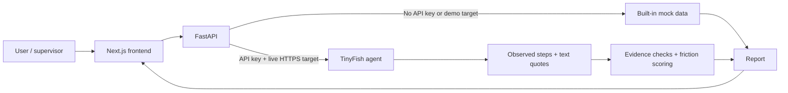

# ExitLens

**A supervised audit tool for documenting friction in online subscription cancellation journeys in India.**

[](https://www.python.org/)
[](https://fastapi.tiangolo.com/)
[](https://nextjs.org/)
[](https://tinyfish.ai/)

## What is ExitLens?

ExitLens walks a subscription cancellation journey and records the friction a user encounters. A supervising person chooses the service, confirms permission and a registered dedicated test account, and starts each audit. The report contains a step timeline, text evidence quotes, weighted friction findings, and candidate links to India's dark-pattern guidelines. ExitLens stops before the final cancellation action and does not submit a cancellation.

## Problem and regulatory context

Cancellation paths can be buried in menus, interrupted by retention offers, or made unclear by confusing controls. India's **Central Consumer Protection Authority (CCPA)** issued the *Guidelines for Prevention and Regulation of Dark Patterns, 2023*, which identify 13 dark-pattern categories. ExitLens uses those categories as review annotations; its output is not a legal finding or a compliance assessment. Read the [official guidelines](https://consumeraffairs.nic.in/sites/default/files/The%20Guidelines%20for%20Prevention%20and%20Regulation%20of%20Dark%20Patterns%2C%202023.pdf).

## Key features

- Next.js interface to select a service, account, start URL, and approval confirmations.
- FastAPI endpoints for presets, dedicated test accounts, run creation, event streaming, stopping, and reports; an additional staged audit API is available under `/api/v1/audits`.
- TinyFish-powered browser runs when configured with an API key and a live HTTPS target.
- Built-in deterministic mock events and reports when a live TinyFish run is not configured. **Without `TINYFISH_API_KEY`, results are demo data, not a real audit.**
- Step-by-step run monitor with an optional live browser view when TinyFish provides one, plus a stop control.
- Reports with text quotes, evidence-linked friction signals, a 0–100 score, CCPA candidate annotations, limitations, and print styling.
- Four local demo pages: a buried cancellation path, a redirect-and-retention path, a fair two-step path, and a security barrier.

## How it works

1. Select a preset or enter a service and HTTPS starting URL.
2. Confirm you have permission and select a registered dedicated test account.
3. Start the audit. The frontend sends the approval flags and selected account reference to FastAPI.
4. FastAPI chooses the deterministic mock path or streams a TinyFish run. The live agent reports observed steps and structured findings.
5. The backend turns finding quotes into text evidence, checks evidence links, deduplicates indicators, and calculates the score.
6. Review the timeline, findings, candidate guideline annotations, and limitations in the report.



## Safety model

**Dedicated test accounts.** The frontend loads accounts from `GET /test-accounts`, requires a selection, and checks that the account matches the selected preset. The v1 API rejects an unregistered account reference when one is supplied; its `test_account_ref` field is optional. The v2 approval endpoint requires a registered `dedicated_test` account and rechecks it when the audit starts. Live identity matching depends on the TinyFish profile or credential binding and the agent reporting an account mismatch; the backend cannot independently inspect the service's authenticated identity.

**Human approval.** The frontend requires both an authorization confirmation and an account-use confirmation, then submits `human_approved: true` and `test_account_confirmed: true`. The v1 API rejects false approval flags, but those flags are client-supplied and the app does not authenticate a human identity. The v2 API has separate create, approve, and start steps; its current `approvedBy` value is a fixed `human_supervisor` label, not an authenticated identity.

**Stop before cancellation.** The TinyFish goal instructs the agent to stop before any final “Cancel subscription” or “Confirm cancellation” control and to report that cancellation was not completed. Reports record the stop reason, and the local demo pages make the final control a harmless alert. This boundary is currently prompt-driven for live browser runs; the backend does not intercept or technically block a browser click on the final control.

## Friction scoring

The score ranges from 0 to 100 and is the sum of verified, deduplicated friction indicator weights. A signal is verified only when it links to a non-empty evidence quote or URL. Repeated signals in the same indicator category remain visible but add points only once; unverified signals add zero.

| Indicator | Weight | What it represents |
|---|---:|---|
| `extra_steps` | Up to 30 | 5 points per step beyond a two-step baseline, capped at 30 |
| `hidden_cancel` | 20 | A buried or visually de-emphasized cancellation control |
| `redirects` | 15 | Misdirection, loops, or dead ends |
| `forced_reason` | 15 | A required survey or reason selection |
| `retention_offer` | 10 | Discount or pause offers interrupting cancellation |
| `unclear_copy` | 10 | Guilt messaging or confusing labels |

The report can associate findings with these 13 categories from India's CCPA 2023 guidelines: `false_urgency`, `basket_sneaking`, `confirm_shaming`, `forced_action`, `subscription_trap`, `interface_interference`, `bait_and_switch`, `drip_pricing`, `disguised_advertisement`, `nagging`, `trick_question`, `saas_billing`, and `rogue_malwares`. These are candidate annotations for human review, not determinations that a service violated a guideline. The live agent's current output schema directly requests seven of the categories; the backend can represent all 13 and supplies default mappings for supported friction indicators.

## Tech stack

| Layer | Technology | Purpose |
|---|---|---|
| Frontend | Next.js 15, React 19, TypeScript | Audit form, live run monitor, and report pages |
| UI styling | Tailwind CSS, PostCSS | Layout and visual styles |
| API | Python 3.11+, FastAPI, Pydantic | Run endpoints, validation, report models, and interactive API docs |
| Server | Uvicorn | Local ASGI development server |
| Browser runner | TinyFish Python SDK | Optional streamed browser automation for live targets |
| Configuration | `python-dotenv` | Load backend settings from `.env` |
| Tests | Python `unittest`, FastAPI `TestClient` | Backend scoring, safety, API, and demo-flow coverage |

## Project structure

```text
.
├── backend/
│   ├── main.py                 # FastAPI application and v1 endpoints
│   ├── orchestrator.py         # TinyFish integration, event streaming, normalization, barriers
│   ├── scoring.py              # Evidence-gated friction score calculation
│   ├── models.py               # Request, event, account, and report schemas
│   ├── v2_audits.py            # Staged /api/v1/audits approval workflow
│   ├── test_accounts.py        # Server-side dedicated test-account registry
│   ├── mock_data.py            # Presets, deterministic mock steps, and reports
│   ├── test_backend.py         # Backend unit and integration tests
│   └── demo_site/              # Local mock subscription sites
├── frontend/
│   ├── app/                    # Home, audit, run, report, and explainer routes
│   ├── components/             # Audit form, run monitor, report, and shared UI
│   ├── lib/api.ts              # Frontend API client and shared types
│   └── package.json            # Frontend scripts and dependencies
├── docs/
│   ├── api-contract.md         # v1 and v2 API contracts
│   └── project-brief.md        # Product scope and safety principles
└── README.md
```

## Getting started

### Prerequisites

- Git
- Python 3.11 or newer
- Node.js 18.18 or newer and npm
- A TinyFish API key only for live browser runs; the local mock flow works without one

### Clone the repository

```bash
git clone https://github.com/Ritweek17/ExitLens-HACKIIITD.git
```

```bash
cd ExitLens-HACKIIITD
```

### Set up the backend

```bash
cd backend
```

```bash
python3 -m venv .venv
```

```bash
source .venv/bin/activate
```

On Windows PowerShell, activate the environment with:

```powershell
.venv\Scripts\Activate.ps1
```

Install the backend and test dependencies. `tinyfish` is included in `requirements.txt` so the test suite can import and exercise the runner adapter.

```bash
python -m pip install --upgrade pip
```

```bash
pip install -r requirements.txt
```

Create the backend environment file. You can leave the key blank to use deterministic demo data.

```bash
cp .env.example .env
```

Start the API from the `backend/` directory:

```bash
uvicorn main:app --reload
```

The API is at `http://localhost:8000`; interactive docs are at `http://localhost:8000/docs`.

### Run the backend tests

In a second terminal, change to the repository root and activate the backend virtual environment if needed:

```bash
cd ExitLens-HACKIIITD
```

```bash
source backend/.venv/bin/activate
```

Run the full unittest suite:

```bash
python -m unittest discover -s backend -p 'test_*.py' -v
```

### Set up the frontend

In another terminal, from the repository root:

```bash
cd frontend
```

```bash
npm ci
```

```bash
cp .env.example .env.local
```

```bash
npm run dev
```

Open `http://localhost:3000`.

### Environment variables

The backend reads `backend/.env`; the frontend reads `frontend/.env.local`. All backend variables below are listed in [`backend/.env.example`](backend/.env.example). Empty values use the defaults shown.

| Variable | Purpose and default |
|---|---|
| `TINYFISH_API_KEY` | TinyFish server-side API key. **If empty, runs use built-in mock/demo data and are not real website audits.** |
| `ALLOWED_ORIGINS` | Comma-separated frontend origins allowed by CORS. Defaults to `http://localhost:5173,http://localhost:3000`. |
| `PUBLIC_DEMO_BASE_URL` | Optional public HTTPS base URL for this backend. With a key, preset runs without a start URL can target the matching `/demo-site/` route through this address. TinyFish cannot reach your local `localhost` address. |
| `TINYFISH_BROWSER_PROFILE` | Optional `stealth` or `lite` browser profile. Default is `stealth` for external hosts and `lite` for tunnel hosts. |
| `TINYFISH_PROXY_COUNTRY` | Optional two-letter country code for the TinyFish proxy on external targets, such as `IN`. |
| `TINYFISH_PROFILE_ID` | Optional TinyFish browser context profile ID used for registered test accounts without their own profile ID. |
| `TINYFISH_USE_VAULT` | Set to `1`, `true`, or `yes` to request the TinyFish credential vault for external runs. |
| `TINYFISH_CREDENTIAL_ITEM_IDS` | Optional comma-separated TinyFish vault item IDs. These are bound to registered test accounts without their own credential item IDs. |
| `TINYFISH_RUN_TIMEOUT_SECONDS` | Maximum live run duration in seconds. Defaults to 300. |
| `MAX_RUNS` | Maximum number of in-memory run records before inactive records are evicted. Defaults to 200; active runs are retained. |
| `RUN_TTL_SECONDS` | Age in seconds after which finished or idle records expire. Defaults to 3600. |
| `ALLOWED_AUDIT_HOSTS` | Optional comma-separated host allowlist for audit URLs; subdomains are included. Empty means no additional restriction. Presets and configured demo tunnels are allowed. |
| `TEST_ACCOUNTS_JSON` | Optional JSON array for adding registered dedicated test accounts. Entries can include `id`, `service`, `masked_identifier`, `kind`, `profile_id`, and `credential_item_ids`. |
| `NEXT_PUBLIC_API_BASE_URL` | Frontend API base URL in `frontend/.env.example`. Defaults to `http://localhost:8000`. |

Keep credentials in the backend environment only. Do not put TinyFish keys, passwords, or session secrets in frontend variables or commits.

### Run the demo site

With the backend running, open these local pages:

- [StreamFlix buried cancellation demo](http://localhost:8000/demo-site/)
- [GanaPlus redirect and retention demo](http://localhost:8000/demo-site/music.html)
- [QuickCart fair-flow demo](http://localhost:8000/demo-site/fair.html)
- [CineVeil security-barrier demo](http://localhost:8000/demo-site/blocked.html)

The pages are served by FastAPI. Opening them locally does not make the cloud TinyFish browser able to reach them. Live browser audits of a local demo require a public HTTPS tunnel and `PUBLIC_DEMO_BASE_URL`; the `backend/start_live_demo.py` helper can open a tunnel and start the server. Without a TinyFish API key, the application returns predefined demo reports instead of crawling these pages.

## Usage

1. Open **Start an audit**, select a preset (or enter a service), and choose a registered dedicated test account.
2. Leave the preset URL empty for the built-in demo route, or select/enter an HTTPS URL for a live external target. A live run needs `TINYFISH_API_KEY` and an account configured for the target.
3. Confirm that you have permission and approve use of the selected dedicated test account, then start the audit.
4. The run monitor shows streamed step labels, the current status, an optional TinyFish browser view, and a **Stop Audit** control. It moves to the report when the stream reports completion.
5. In the report, review the score and findings, expand each finding to read its evidence quote, use the timeline to follow the observed steps, and check candidate CCPA alignments and listed limitations.

If no API key is configured, the report is generated from deterministic mock data. Treat it as a product demo and not as evidence collected from the named external service.

## Demo flows

The built-in report fixtures provide these example scores:

| Demo service | Fixture behavior | Expected score |
|---|---|---:|
| StreamFlix India | Buried cancel link, retention offer, and guilt-framed copy | 65 |
| GanaPlus Music | Redirect loop, hidden link, required survey, retention offer, and confusing copy | 90 |
| QuickCart Pro | Direct two-step path with clear billing notice | 0 |
| CineVeil VIP | CAPTCHA / OTP barrier; human assistance required | 0 |

These values come from deterministic fallback reports. For live runs, findings and scores depend on the target and observed evidence. The fair demo stops at the final confirmation screen just like the other demo pages; it does not cancel anything.

<!-- TODO: add screenshot or GIF of the audit form, run monitor, and report. -->

## Limitations and roadmap

**Current limitations**

- Live browsing, step descriptions, and account identity checks depend on TinyFish and the configured test-account context.
- The live stop-before-cancel rule is stated in the agent prompt; the backend does not technically intercept the final browser click.
- Backend run records are held in memory and are lost when the server restarts.
- Current report evidence is stored as text quotes/descriptions. The backend report normalizer does not store DOM snapshots; generated screenshots are not part of the evidence pipeline.
- The v1 approval flags are client-supplied, and the app does not authenticate a supervisor.

**Possible next steps**

- Authenticate supervisors and persist approval records and audit runs.
- Bind and verify dedicated test-account identities more strongly before live navigation.
- Capture, redact, and retain screenshots or other evidence resources with access controls.
- Add an enforceable browser-level cancellation boundary and broaden automated evaluation coverage.

## Team and hackathon

Built for **HackIIITD / ESYA'26**.

- **Team:** Creative-Curator
- **Members:** Ritweek Dubey , Richa Kumari Verma , Vivek Yadav
- **Project presentation:** [Link, if available]

## License

This repository does not currently contain a `LICENSE` file. No reuse or redistribution license is specified yet.

## Responsible use

Use ExitLens only on services and accounts you are authorized to test. Use registered dedicated test accounts, never a real person's personal account. Review every result as an observation for human assessment; CCPA annotations are candidates, not legal conclusions.
